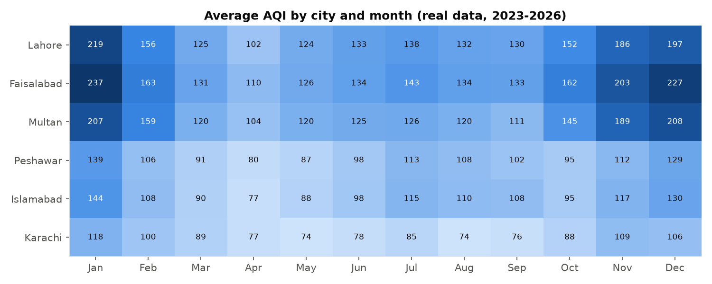
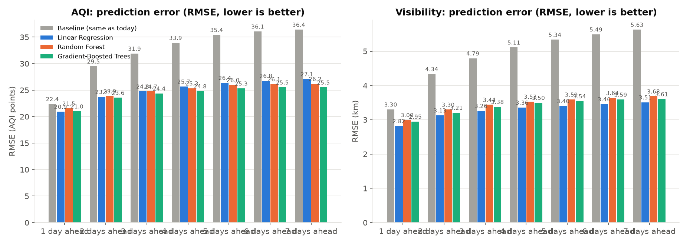
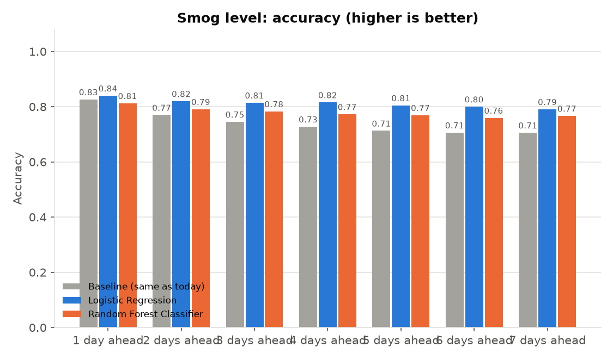
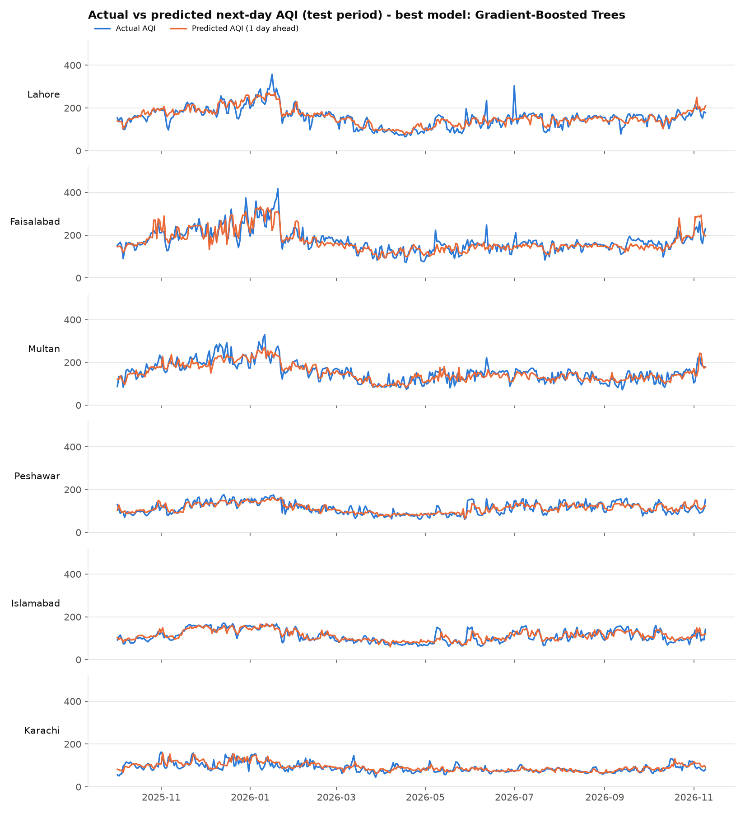
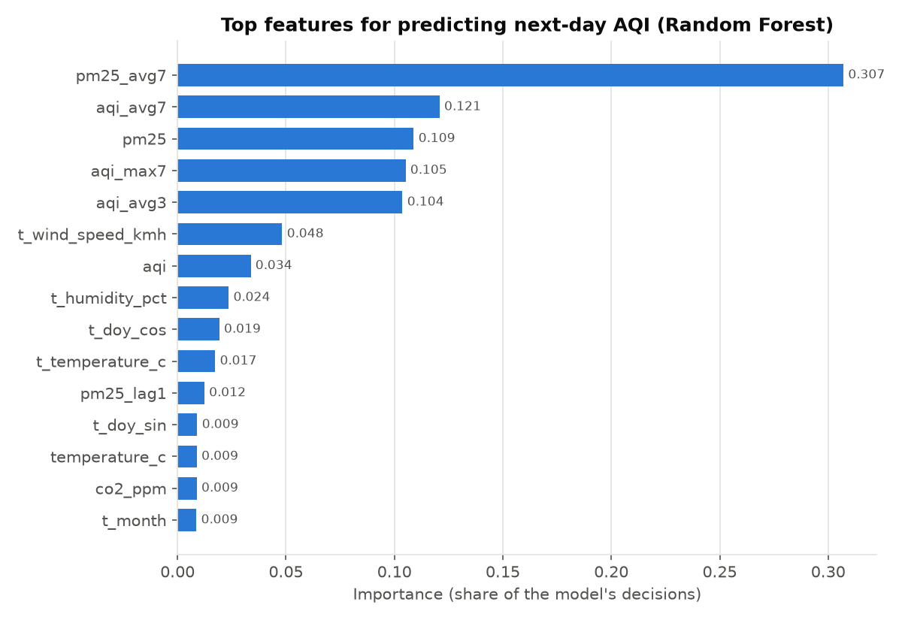
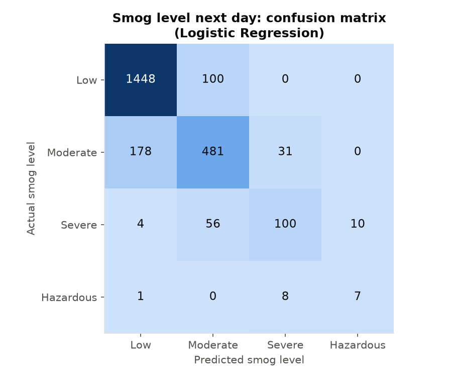

# Pakistan Smog Early-Warning Pipeline (PySpark, live data)

_Report generated automatically by `run_pipeline.py` on 2026-11-10 20:22._

> Data: real hourly air-quality (CAMS, via Open-Meteo) and weather data for six Pakistani cities since 2023, aggregated to daily values. AQI is calculated with the US-EPA formula.

## 1. Data quality (cleaning step)

| check | count |
|---|---|
| Rows loaded | 8502 |
| Duplicate rows removed | 0 |
| Impossible values in temperature_c | 0 |
| Impossible values in humidity_pct | 0 |
| Impossible values in wind_speed_kmh | 0 |
| Impossible values in rainfall_mm | 0 |
| Impossible values in pm25 | 0 |
| Impossible values in pm10 | 0 |
| Impossible values in no2_ugm3 | 0 |
| Impossible values in so2_ugm3 | 0 |
| Impossible values in co_ugm3 | 0 |
| Impossible values in ozone_ugm3 | 0 |
| Impossible values in co2_ppm | 0 |
| Impossible values in dust_ugm3 | 0 |
| Missing values filled in pm25 | 0 |
| Missing values filled in pm10 | 0 |
| Missing values filled in no2_ugm3 | 0 |
| Missing values filled in so2_ugm3 | 0 |
| Missing values filled in co_ugm3 | 0 |
| Missing values filled in ozone_ugm3 | 0 |
| Missing values filled in co2_ppm | 3984 |
| Missing values filled in dust_ugm3 | 0 |
| Missing values filled in temperature_c | 0 |
| Missing values filled in humidity_pct | 0 |
| Missing values filled in wind_speed_kmh | 0 |
| Missing values filled in rainfall_mm | 0 |
| Clean past city-days | 8454 |
| Forecast-weather city-days | 48 |

## 2. City overview

| city | avg_aqi | avg_pm25 | avg_visibility_km | max_aqi | severe_days | hazardous_days |
|---|---|---|---|---|---|---|
| Faisalabad | 156.5 | 75.2 | 10.11 | 425.0 | 162 | 33 |
| Lahore | 148.2 | 68.0 | 10.05 | 472.0 | 134 | 11 |
| Multan | 142.3 | 64.8 | 11.94 | 335.0 | 127 | 6 |
| Islamabad | 106.1 | 37.6 | 16.06 | 190.0 | 0 | 0 |
| Peshawar | 104.4 | 36.6 | 16.44 | 176.0 | 0 | 0 |
| Karachi | 88.8 | 28.9 | 18.07 | 196.0 | 0 | 0 |

**Insight:** Faisalabad has the worst air (average AQI 156.5, 33 hazardous days). Karachi and Islamabad are the cleanest.

## 3. What drives AQI?

Correlation of each measured column with AQI (closer to +1 or -1 = stronger link):

| feature | correlation_with_aqi |
|---|---|
| pm25 | 0.958 |
| pm10 | 0.831 |
| visibility_km | -0.823 |
| co_ugm3 | 0.712 |
| so2_ugm3 | 0.638 |
| no2_ugm3 | 0.56 |
| wind_speed_kmh | -0.406 |
| temperature_c | -0.354 |
| humidity_pct | 0.188 |
| co2_ppm | 0.184 |

Top 10 features used by the Random Forest for next-day AQI:

| feature | importance |
|---|---|
| pm25_avg7 | 0.30706 |
| aqi_avg7 | 0.12081 |
| pm25 | 0.10892 |
| aqi_max7 | 0.10516 |
| aqi_avg3 | 0.10374 |
| t_wind_speed_kmh | 0.04828 |
| aqi | 0.03375 |
| t_humidity_pct | 0.0236 |
| t_doy_cos | 0.01927 |
| t_temperature_c | 0.01739 |

## 4. Model results (test period: 2025-10-01 onwards)

**Baseline** = 'the value will be the same as today'. A model is useful only if it beats it.

### Model 1: AQI and visibility (regression)

| target | horizon_days | model | rmse | mae | r2 | best_params |
|---|---|---|---|---|---|---|
| aqi | 1 | Baseline (same as today) | 22.3886 | 15.4563 | 0.7899 | - |
| aqi | 2 | Baseline (same as today) | 29.4861 | 20.7754 | 0.6357 | - |
| aqi | 3 | Baseline (same as today) | 31.8917 | 22.8445 | 0.5743 | - |
| aqi | 4 | Baseline (same as today) | 33.9332 | 24.6804 | 0.5185 | - |
| aqi | 5 | Baseline (same as today) | 35.4278 | 25.6217 | 0.4757 | - |
| aqi | 6 | Baseline (same as today) | 36.0652 | 26.2924 | 0.4569 | - |
| aqi | 7 | Baseline (same as today) | 36.4077 | 26.4276 | 0.447 | - |
| aqi | 1 | Linear Regression | 20.9292 | 15.7125 | 0.8164 | regParam=0.0, elasticNetParam=0.0 |
| aqi | 2 | Linear Regression | 23.7465 | 17.6469 | 0.7637 | regParam=0.0, elasticNetParam=0.0 |
| aqi | 3 | Linear Regression | 24.7587 | 18.4728 | 0.7434 | regParam=0.0, elasticNetParam=0.0 |
| aqi | 4 | Linear Regression | 25.6643 | 19.231 | 0.7246 | regParam=0.0, elasticNetParam=0.0 |
| aqi | 5 | Linear Regression | 26.3833 | 19.6756 | 0.7092 | regParam=0.0, elasticNetParam=0.0 |
| aqi | 6 | Linear Regression | 26.7556 | 20.05 | 0.7011 | regParam=0.0, elasticNetParam=0.0 |
| aqi | 7 | Linear Regression | 27.0887 | 20.2896 | 0.6939 | regParam=0.0, elasticNetParam=0.0 |
| aqi | 1 | Random Forest | 21.5456 | 16.1795 | 0.8054 | numTrees=50, maxDepth=8 |
| aqi | 2 | Random Forest | 23.8608 | 17.9766 | 0.7615 | numTrees=50, maxDepth=8 |
| aqi | 3 | Random Forest | 24.7406 | 18.7809 | 0.7438 | numTrees=50, maxDepth=8 |
| aqi | 4 | Random Forest | 25.3331 | 19.3639 | 0.7316 | numTrees=50, maxDepth=8 |
| aqi | 5 | Random Forest | 25.967 | 19.7433 | 0.7183 | numTrees=50, maxDepth=8 |
| aqi | 6 | Random Forest | 26.1236 | 20.0792 | 0.715 | numTrees=50, maxDepth=8 |
| aqi | 7 | Random Forest | 26.1777 | 20.1609 | 0.7141 | numTrees=50, maxDepth=8 |
| aqi | 1 | Gradient-Boosted Trees | 20.9971 | 15.5878 | 0.8152 | maxIter=40, maxDepth=4 |
| aqi | 2 | Gradient-Boosted Trees | 23.5656 | 17.5469 | 0.7673 | maxIter=40, maxDepth=4 |
| aqi | 3 | Gradient-Boosted Trees | 24.3706 | 18.2071 | 0.7514 | maxIter=40, maxDepth=4 |
| aqi | 4 | Gradient-Boosted Trees | 24.7948 | 18.4949 | 0.7429 | maxIter=40, maxDepth=4 |
| aqi | 5 | Gradient-Boosted Trees | 25.3156 | 18.9153 | 0.7323 | maxIter=40, maxDepth=4 |
| aqi | 6 | Gradient-Boosted Trees | 25.5168 | 19.2369 | 0.7281 | maxIter=40, maxDepth=4 |
| aqi | 7 | Gradient-Boosted Trees | 25.5109 | 19.1558 | 0.7285 | maxIter=40, maxDepth=4 |
| visibility_km | 1 | Baseline (same as today) | 3.302 | 2.3235 | 0.7445 | - |
| visibility_km | 2 | Baseline (same as today) | 4.3363 | 3.1677 | 0.5585 | - |
| visibility_km | 3 | Baseline (same as today) | 4.7924 | 3.5335 | 0.4603 | - |
| visibility_km | 4 | Baseline (same as today) | 5.1111 | 3.7682 | 0.3864 | - |
| visibility_km | 5 | Baseline (same as today) | 5.3365 | 3.9377 | 0.3315 | - |
| visibility_km | 6 | Baseline (same as today) | 5.4918 | 4.0449 | 0.2936 | - |
| visibility_km | 7 | Baseline (same as today) | 5.6297 | 4.1308 | 0.2585 | - |
| visibility_km | 1 | Linear Regression | 2.8192 | 2.1226 | 0.8137 | regParam=0.0, elasticNetParam=0.0 |
| visibility_km | 2 | Linear Regression | 3.1296 | 2.3529 | 0.77 | regParam=0.0, elasticNetParam=0.0 |
| visibility_km | 3 | Linear Regression | 3.2626 | 2.4536 | 0.7499 | regParam=0.0, elasticNetParam=0.0 |
| visibility_km | 4 | Linear Regression | 3.3565 | 2.5433 | 0.7354 | regParam=0.0, elasticNetParam=0.0 |
| visibility_km | 5 | Linear Regression | 3.4031 | 2.5849 | 0.7282 | regParam=0.0, elasticNetParam=0.0 |
| visibility_km | 6 | Linear Regression | 3.4556 | 2.6178 | 0.7203 | regParam=0.0, elasticNetParam=0.0 |
| visibility_km | 7 | Linear Regression | 3.5119 | 2.6627 | 0.7114 | regParam=0.0, elasticNetParam=0.0 |
| visibility_km | 1 | Random Forest | 2.9953 | 2.2645 | 0.7897 | numTrees=50, maxDepth=8 |
| visibility_km | 2 | Random Forest | 3.2964 | 2.4918 | 0.7449 | numTrees=50, maxDepth=8 |
| visibility_km | 3 | Random Forest | 3.4384 | 2.6091 | 0.7222 | numTrees=50, maxDepth=8 |
| visibility_km | 4 | Random Forest | 3.5314 | 2.6933 | 0.7071 | numTrees=50, maxDepth=8 |
| visibility_km | 5 | Random Forest | 3.5908 | 2.7348 | 0.6973 | numTrees=50, maxDepth=8 |
| visibility_km | 6 | Random Forest | 3.6397 | 2.7683 | 0.6897 | numTrees=50, maxDepth=8 |
| visibility_km | 7 | Random Forest | 3.6849 | 2.8052 | 0.6823 | numTrees=50, maxDepth=8 |
| visibility_km | 1 | Gradient-Boosted Trees | 2.9497 | 2.1585 | 0.7961 | maxIter=40, maxDepth=4 |
| visibility_km | 2 | Gradient-Boosted Trees | 3.2089 | 2.363 | 0.7582 | maxIter=40, maxDepth=4 |
| visibility_km | 3 | Gradient-Boosted Trees | 3.3805 | 2.5219 | 0.7315 | maxIter=40, maxDepth=4 |
| visibility_km | 4 | Gradient-Boosted Trees | 3.4982 | 2.5997 | 0.7126 | maxIter=40, maxDepth=4 |
| visibility_km | 5 | Gradient-Boosted Trees | 3.5431 | 2.6405 | 0.7053 | maxIter=40, maxDepth=4 |
| visibility_km | 6 | Gradient-Boosted Trees | 3.589 | 2.6844 | 0.6983 | maxIter=40, maxDepth=4 |
| visibility_km | 7 | Gradient-Boosted Trees | 3.6051 | 2.709 | 0.6959 | maxIter=40, maxDepth=4 |

**Best model per target:**

| target | horizon_days | best_model | best_rmse | baseline_rmse | error_reduction_vs_baseline |
|---|---|---|---|---|---|
| aqi | 1 | Linear Regression | 20.9292 | 22.3886 | 6.5% |
| aqi | 2 | Gradient-Boosted Trees | 23.5656 | 29.4861 | 20.1% |
| aqi | 3 | Gradient-Boosted Trees | 24.3706 | 31.8917 | 23.6% |
| aqi | 4 | Gradient-Boosted Trees | 24.7948 | 33.9332 | 26.9% |
| aqi | 5 | Gradient-Boosted Trees | 25.3156 | 35.4278 | 28.5% |
| aqi | 6 | Gradient-Boosted Trees | 25.5168 | 36.0652 | 29.2% |
| aqi | 7 | Gradient-Boosted Trees | 25.5109 | 36.4077 | 29.9% |
| visibility_km | 1 | Linear Regression | 2.8192 | 3.302 | 14.6% |
| visibility_km | 2 | Linear Regression | 3.1296 | 4.3363 | 27.8% |
| visibility_km | 3 | Linear Regression | 3.2626 | 4.7924 | 31.9% |
| visibility_km | 4 | Linear Regression | 3.3565 | 5.1111 | 34.3% |
| visibility_km | 5 | Linear Regression | 3.4031 | 5.3365 | 36.2% |
| visibility_km | 6 | Linear Regression | 3.4556 | 5.4918 | 37.1% |
| visibility_km | 7 | Linear Regression | 3.5119 | 5.6297 | 37.6% |

### Model 2: smog level (classification)

| horizon_days | model | accuracy | f1 | weightedPrecision | weightedRecall |
|---|---|---|---|---|---|
| 1 | Baseline (same as today) | 0.8267 | 0.8266 | 0.8264 | 0.8267 |
| 2 | Baseline (same as today) | 0.7701 | 0.7698 | 0.7695 | 0.7701 |
| 3 | Baseline (same as today) | 0.7454 | 0.745 | 0.7446 | 0.7454 |
| 4 | Baseline (same as today) | 0.7278 | 0.7273 | 0.7268 | 0.7278 |
| 5 | Baseline (same as today) | 0.7129 | 0.7122 | 0.7116 | 0.7129 |
| 6 | Baseline (same as today) | 0.7063 | 0.7054 | 0.7046 | 0.7063 |
| 7 | Baseline (same as today) | 0.706 | 0.7049 | 0.7038 | 0.706 |
| 1 | Logistic Regression | 0.8399 | 0.8363 | 0.8351 | 0.8399 |
| 2 | Logistic Regression | 0.8205 | 0.8167 | 0.8146 | 0.8205 |
| 3 | Logistic Regression | 0.8147 | 0.81 | 0.8074 | 0.8147 |
| 4 | Logistic Regression | 0.8159 | 0.8103 | 0.8081 | 0.8159 |
| 5 | Logistic Regression | 0.805 | 0.799 | 0.7961 | 0.805 |
| 6 | Logistic Regression | 0.8003 | 0.7935 | 0.7903 | 0.8003 |
| 7 | Logistic Regression | 0.791 | 0.7834 | 0.7806 | 0.791 |
| 1 | Random Forest Classifier | 0.8127 | 0.7987 | 0.7986 | 0.8127 |
| 2 | Random Forest Classifier | 0.7911 | 0.7758 | 0.7747 | 0.7911 |
| 3 | Random Forest Classifier | 0.7832 | 0.7671 | 0.7664 | 0.7832 |
| 4 | Random Forest Classifier | 0.7727 | 0.7561 | 0.7546 | 0.7727 |
| 5 | Random Forest Classifier | 0.7696 | 0.7519 | 0.7512 | 0.7696 |
| 6 | Random Forest Classifier | 0.7598 | 0.7423 | 0.7411 | 0.7598 |
| 7 | Random Forest Classifier | 0.7668 | 0.7485 | 0.7502 | 0.7668 |

## 5. Latest forecast (next 7 days)

| city | forecast_date | days_ahead | predicted_aqi | predicted_visibility_km | predicted_smog_level | health_advice |
|---|---|---|---|---|---|---|
| Faisalabad | 2026-11-10 | 1 | 287.0 | 4.45 | Severe | Mask outdoors, avoid exercise |
| Faisalabad | 2026-11-11 | 2 | 283.0 | 4.59 | Moderate | Sensitive groups limit outdoors |
| Faisalabad | 2026-11-12 | 3 | 235.0 | 5.87 | Moderate | Sensitive groups limit outdoors |
| Faisalabad | 2026-11-13 | 4 | 236.0 | 5.65 | Moderate | Sensitive groups limit outdoors |
| Faisalabad | 2026-11-14 | 5 | 236.0 | 6.62 | Moderate | Sensitive groups limit outdoors |
| Faisalabad | 2026-11-15 | 6 | 210.0 | 6.36 | Moderate | Sensitive groups limit outdoors |
| Faisalabad | 2026-11-16 | 7 | 175.0 | 9.0 | Moderate | Sensitive groups limit outdoors |
| Lahore | 2026-11-10 | 1 | 212.0 | 5.54 | Moderate | Sensitive groups limit outdoors |
| Lahore | 2026-11-11 | 2 | 198.0 | 7.04 | Moderate | Sensitive groups limit outdoors |
| Lahore | 2026-11-12 | 3 | 203.0 | 6.43 | Moderate | Sensitive groups limit outdoors |
| Lahore | 2026-11-13 | 4 | 190.0 | 8.64 | Moderate | Sensitive groups limit outdoors |
| Lahore | 2026-11-14 | 5 | 200.0 | 7.51 | Moderate | Sensitive groups limit outdoors |
| Lahore | 2026-11-15 | 6 | 190.0 | 8.79 | Moderate | Sensitive groups limit outdoors |
| Lahore | 2026-11-16 | 7 | 190.0 | 9.54 | Moderate | Sensitive groups limit outdoors |
| Multan | 2026-11-10 | 1 | 189.0 | 7.7 | Moderate | Sensitive groups limit outdoors |
| Multan | 2026-11-11 | 2 | 191.0 | 6.83 | Moderate | Sensitive groups limit outdoors |
| Multan | 2026-11-12 | 3 | 177.0 | 6.44 | Moderate | Sensitive groups limit outdoors |
| Multan | 2026-11-13 | 4 | 172.0 | 5.42 | Moderate | Sensitive groups limit outdoors |
| Multan | 2026-11-14 | 5 | 170.0 | 7.73 | Moderate | Sensitive groups limit outdoors |
| Multan | 2026-11-15 | 6 | 179.0 | 8.67 | Moderate | Sensitive groups limit outdoors |
| Multan | 2026-11-16 | 7 | 188.0 | 9.33 | Moderate | Sensitive groups limit outdoors |
| Islamabad | 2026-11-10 | 1 | 155.0 | 12.14 | Low | Air acceptable |
| Islamabad | 2026-11-11 | 2 | 148.0 | 9.99 | Low | Air acceptable |
| Islamabad | 2026-11-12 | 3 | 134.0 | 10.48 | Low | Air acceptable |
| Islamabad | 2026-11-13 | 4 | 126.0 | 9.98 | Low | Air acceptable |
| Islamabad | 2026-11-14 | 5 | 131.0 | 12.42 | Low | Air acceptable |
| Islamabad | 2026-11-15 | 6 | 134.0 | 14.15 | Low | Air acceptable |
| Islamabad | 2026-11-16 | 7 | 132.0 | 16.43 | Low | Air acceptable |
| Peshawar | 2026-11-10 | 1 | 153.0 | 9.53 | Low | Air acceptable |
| Peshawar | 2026-11-11 | 2 | 146.0 | 8.94 | Moderate | Sensitive groups limit outdoors |
| Peshawar | 2026-11-12 | 3 | 140.0 | 8.32 | Low | Air acceptable |
| Peshawar | 2026-11-13 | 4 | 140.0 | 7.61 | Low | Air acceptable |
| Peshawar | 2026-11-14 | 5 | 135.0 | 10.34 | Low | Air acceptable |
| Peshawar | 2026-11-15 | 6 | 126.0 | 14.36 | Low | Air acceptable |
| Peshawar | 2026-11-16 | 7 | 123.0 | 16.26 | Low | Air acceptable |
| Karachi | 2026-11-10 | 1 | 93.0 | 14.1 | Low | Air acceptable |
| Karachi | 2026-11-11 | 2 | 95.0 | 13.97 | Low | Air acceptable |
| Karachi | 2026-11-12 | 3 | 89.0 | 13.48 | Low | Air acceptable |
| Karachi | 2026-11-13 | 4 | 94.0 | 14.76 | Low | Air acceptable |
| Karachi | 2026-11-14 | 5 | 96.0 | 13.26 | Low | Air acceptable |
| Karachi | 2026-11-15 | 6 | 96.0 | 12.78 | Low | Air acceptable |
| Karachi | 2026-11-16 | 7 | 98.0 | 13.46 | Low | Air acceptable |

## 6. Smog early-warning bulletin (latest)

```
==============================================================================
SMOG EARLY-WARNING BULLETIN (automated)
Based on data up to: 2026-11-09   |   Outlook: next 7 days
Generated automatically by the PySpark pipeline from real Open-Meteo (CAMS) air-quality and weather data
==============================================================================

SUMMARY: 0 city(ies) Hazardous, 1 city(ies) Severe, 3 city(ies) Moderate, 2 city(ies) Low

--- FAISALABAD : SEVERE (max AQI 287, trend falling) ---
Outlook   : 2026-11-10: AQI 287, Severe
            2026-11-11: AQI 283, Moderate
            2026-11-12: AQI 235, Moderate
            2026-11-13: AQI 236, Moderate
            2026-11-14: AQI 236, Moderate
            2026-11-15: AQI 210, Moderate
            2026-11-16: AQI 175, Moderate
Visibility: lowest 4.45 km
Public    : Wear an N95 mask outdoors. Avoid outdoor exercise. Keep windows closed.
Warnings  :
  ! Pollutant warning: Coarse dust high (construction, roads): 168 (limit 150)
Actions   :
  - Education department: cancel outdoor school activities and sports.
  - Environment department: increase patrols against crop-residue burning.
  - City administration: water sprinkling on main roads to settle dust.
  - Hospitals: prepare for more respiratory patients.
  - City administration: stop open construction, cover sand and soil, sprinkle water on roads.

--- LAHORE : MODERATE (max AQI 212, trend falling) ---
Outlook   : 2026-11-10: AQI 212, Moderate
            2026-11-11: AQI 198, Moderate
            2026-11-12: AQI 203, Moderate
            2026-11-13: AQI 190, Moderate
            2026-11-14: AQI 200, Moderate
            2026-11-15: AQI 190, Moderate
            2026-11-16: AQI 190, Moderate
Visibility: lowest 5.54 km
Public    : Children, elderly and heart/lung patients should limit time outdoors.
Actions   :
  - Health department: issue advisory for sensitive groups.
  - Environment department: monitor crop-burning hotspots.

--- MULTAN : MODERATE (max AQI 191, trend steady) ---
Outlook   : 2026-11-10: AQI 189, Moderate
            2026-11-11: AQI 191, Moderate
            2026-11-12: AQI 177, Moderate
            2026-11-13: AQI 172, Moderate
            2026-11-14: AQI 170, Moderate
            2026-11-15: AQI 179, Moderate
            2026-11-16: AQI 188, Moderate
Visibility: lowest 5.42 km
Public    : Children, elderly and heart/lung patients should limit time outdoors.
Actions   :
  - Health department: issue advisory for sensitive groups.
  - Environment department: monitor crop-burning hotspots.

--- PESHAWAR : MODERATE (max AQI 153, trend falling) ---
Outlook   : 2026-11-10: AQI 153, Low
            2026-11-11: AQI 146, Moderate
            2026-11-12: AQI 140, Low
            2026-11-13: AQI 140, Low
            2026-11-14: AQI 135, Low
            2026-11-15: AQI 126, Low
            2026-11-16: AQI 123, Low
Visibility: lowest 7.61 km
Public    : Children, elderly and heart/lung patients should limit time outdoors.
Actions   :
  - Health department: issue advisory for sensitive groups.
  - Environment department: monitor crop-burning hotspots.

--- ISLAMABAD : LOW (max AQI 155, trend falling) ---
Outlook   : 2026-11-10: AQI 155, Low
            2026-11-11: AQI 148, Low
            2026-11-12: AQI 134, Low
            2026-11-13: AQI 126, Low
            2026-11-14: AQI 131, Low
            2026-11-15: AQI 134, Low
            2026-11-16: AQI 132, Low
Visibility: lowest 9.98 km
Public    : Air is acceptable. No special precautions.
Actions   :
  - No action needed.

--- KARACHI : LOW (max AQI 98, trend steady) ---
Outlook   : 2026-11-10: AQI 93, Low
            2026-11-11: AQI 95, Low
            2026-11-12: AQI 89, Low
            2026-11-13: AQI 94, Low
            2026-11-14: AQI 96, Low
            2026-11-15: AQI 96, Low
            2026-11-16: AQI 98, Low
Visibility: lowest 12.78 km
Public    : Air is acceptable. No special precautions.
Actions   :
  - No action needed.

AQI guide: 0-150 Low | 151-200 Moderate | 201-300 Severe | 301-500 Hazardous
```

## 7. Charts












